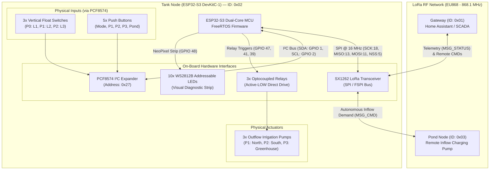

# ESP32-S3 + SX1262 LoRa Tank Node ("Bazin Apă")

Firmware for an intelligent water reservoir management and automated irrigation controller powered by an **ESP32-S3** and **Semtech SX1262 LoRa** transceiver. 

The node monitors water depth via 3 stepped float switches, orchestrates 3 parallel outflow irrigation pump relays, and automates an inflow charging pump located at a remote pond node over long-range LoRa RF.

---

## 1. System Architecture



---

## 2. Hardware Pinout & Wiring

### A. SX1262 LoRa Radio (SPI / FSPI Bus)
| ESP32-S3 GPIO | SX1262 Pin | Signal | Description |
| :--- | :--- | :--- | :--- |
| **GPIO 18** | SCK | SPI Clock | 16 MHz SPI bus |
| **GPIO 13** | MISO | SPI MISO | Master In Slave Out |
| **GPIO 11** | MOSI | SPI MOSI | Master Out Slave In |
| **GPIO 5** | NSS (CS) | Chip Select | Active-LOW SPI slave select |
| **GPIO 14** | NRESET | Reset | Active-LOW hardware reset |
| **GPIO 17** | BUSY | Status | SX1262 busy status indicator |
| **GPIO 16** | DIO1 (IRQ)| Interrupt | RX/TX done interrupt line |
| **3.3V / GND** | 3V3 / GND | Power | Regulated 3.3V supply (max 120 mA TX peak) |

### B. Outflow Pump Relays (Direct Drive, Active-LOW)
> [!TIP]
> The relay inputs are active-LOW (`LOW = Relay ON / Pump Running`). To avoid inductive back-EMF crashes when switching pump motors, use an optically isolated relay board with a separate 5V `JD-VCC` supply and place an RC snubber across the relay contacts.

| ESP32-S3 GPIO | Channel | Relay Logic | Description |
| :--- | :--- | :--- | :--- |
| **GPIO 47** | Relay 1 | `LOW = ON` | **Pump 1** (Parallel Outflow Irrigation) |
| **GPIO 41** | Relay 2 | `LOW = ON` | **Pump 2** (Parallel Outflow Irrigation) |
| **GPIO 39** | Relay 3 | `LOW = ON` | **Pump 3** (Parallel Outflow Irrigation) |

### C. I²C Bus & PCF8574 Expander (Address: `0x27`)
| ESP32-S3 GPIO | PCF8574 Pin | Function | Logic |
| :--- | :--- | :--- | :--- |
| **GPIO 1** | SDA | I²C Data Line | External 10k pull-up to 3.3V |
| **GPIO 2** | SCL | I²C Clock Line | External 10k pull-up to 3.3V |
| *PCF Port 0* | **P0** (Bit 0) | **Float Switch Level 1** | Low float (`0 = Submerged`, `1 = Dry`) |
| *PCF Port 1* | **P1** (Bit 1) | **Float Switch Level 2** | Mid float (`0 = Submerged`, `1 = Dry`) |
| *PCF Port 2* | **P2** (Bit 2) | **Float Switch Level 3** | High float (`0 = Submerged`, `1 = Dry`) |
| *PCF Port 3* | **P3** (Bit 3) | **Button: Mode** | Toggles AUTO $\leftrightarrow$ MANUAL |
| *PCF Port 4* | **P4** (Bit 4) | **Button: Pump 1** | Manual toggle / Auto arm toggle |
| *PCF Port 5* | **P5** (Bit 5) | **Button: Pump 2** | Manual toggle / Auto arm toggle |
| *PCF Port 6* | **P6** (Bit 6) | **Button: Pump 3** | Manual toggle / Auto arm toggle |
| *PCF Port 7* | **P7** (Bit 7) | **Button: Pond** | Manual Pond pump command toggle |

### D. WS2812B NeoPixel RGB LED Strip (10 LEDs)
* **Control Pin**: **GPIO 48**
* **LED Pixel Mapping**:
  * **LED 0**: System State / Tank Refill Demand
    * *Red*: Manual mode or no pumps armed
    * *Orange*: Tank charging cycle running (Pond pump active)
    * *Blue*: Tank satisfied / full
  * **LEDs 1–3**: Water Level Gauge (`WL=1` $\rightarrow$ LED 1; `WL=2` $\rightarrow$ LED 1+2; `WL=3` $\rightarrow$ LED 1+2+3)
  * **LED 4**: Status & RF Activity Flash
    * *Green*: Auto mode / *Orange*: Manual mode
    * *Flash Purple*: LoRa packet received
    * *Flash Cyan*: LoRa packet transmitted
    * *Red*: Gateway timeout error (60s without gateway ping)
    * *Magenta*: **Sensor Plausibility Fault** (invalid float combination)
    * *Yellow*: **PCF8574 I²C Bus Error** (disconnected expander)
  * **LED 5**: Remote Pond Pump State (*Green*: Running / *Red*: Idle)
  * **LED 6**: Operational Mode (*Green*: Auto / *Blue*: Manual)
  * **LED 7**: **Pump 3** Indicator (Green fading with water capacity; Pulsing Cyan when waiting for refill)
  * **LED 8**: **Pump 2** Indicator
  * **LED 9**: **Pump 1** Indicator

---

## 3. LoRa RF Communication & Protocol

### Radio Physical Layer
* **Frequency**: `868.1 MHz` (EU868 ISM band)
* **Modulation**: LoRa (SF9, BW 125 kHz, CR 4/5)
* **Transmit Power**: `+22 dBm`
* **Sync Word**: `0x1424` (SX126x private network)
* **Duty Cycle Management**: 30-second periodic heartbeat with immediate event-driven alerts to guarantee $<1\%$ airtime usage.

### Packet Framing (`__attribute__((packed))`)

#### 1. Header (`LoRaHeader`, 5 bytes)
```
+---------------+---------------+---------------+---------------+---------------+
| Byte 0        | Byte 1        | Byte 2        | Byte 3        | Byte 4        |
|      Magic (0x5A6B)           |   Target ID   |   Sender ID   | MsgType (1/2) |
+---------------+---------------+---------------+---------------+---------------+
```
* **Network Magic**: `0x5A6B` (foreign packets rejected)
* **Node IDs**: `0x01` (Gateway), `0x02` (Tank Node), `0x03` (Pond Node), `0xFF` (Broadcast)
* **Message Types**: `1` = `MSG_STATUS`, `2` = `MSG_CMD`

#### 2. Status Telemetry (`MSG_STATUS`, 11 bytes total)
```
+---------------+---------------+---------------+---------------+---------------+---------------+
| LoRaHeader    | Byte 5        | Byte 6        | Byte 7..8     | Byte 9        | Byte 10       |
| (5 bytes)     | Flags         | Water Level   | Temp (int16)  | Humidity (u8) | Reserved (u8) |
+---------------+---------------+---------------+---------------+---------------+---------------+
```
* **Flags**:
  * Bit 0 (`0x01`): Auto mode active
  * Bit 1 (`0x02`): Pump 1 relay active
  * Bit 2 (`0x04`): Pump 2 relay active
  * Bit 3 (`0x08`): Pump 3 relay active
  * Bit 4 (`0x10`): Pond pump demand active

#### 3. Remote Command (`MSG_CMD`, 8 bytes total)
```
+---------------+---------------+---------------+---------------+
| LoRaHeader    | Byte 5        | Byte 6        | Byte 7        |
| (5 bytes)     | Target Mask   | Action        | Value         |
+---------------+---------------+---------------+---------------+
```
* **Target Mask**: `0x01` (Mode), `0x02` (P1), `0x04` (P2), `0x08` (P3), `0x10` (Pond)
* **Action**: `0x00` (Toggle), `0x01` (Set)
* **Value**: `0x00` (OFF / Manual), `0x01` (ON / Auto)

---

## 4. Control Logic & Safety Protections

### 1. Relay Anti-Chatter & Cooldown Engine
* **Minimum Runtime (`20s`)**: Once switched on, a pump cannot be toggled off before 20 seconds have elapsed.
* **Minimum Cooldown (`20s`)**: Once turned off, a pump cannot restart before a 20-second resting window elapses, preventing contactor thermal stress and pressure spikes.
* **Emergency Dry-Run Override**: If `waterLevel == 0`, the minimum runtime is bypassed immediately to shut down pumps and protect mechanical seals from running dry.

### 2. Sensor Plausibility & Water Sloshing Filter
* **Slosh Debouncing**: Water level transitions must remain steady for **1500 ms** (`FLOAT_DEBOUNCE_MS`) before being latched, preventing false triggers from ripples and waves.
* **Plausibility Verification**: Valid float switch combinations must be contiguous from the bottom up (`0b111` $\rightarrow$ WL:0, `0b110` $\rightarrow$ WL:1, `0b100` $\rightarrow$ WL:2, `0b000` $\rightarrow$ WL:3). Any non-contiguous pattern (such as upper float submerged while lower float is dry) triggers `ERR_FLOAT_PLAUSIBILITY`, sets `waterLevelValid = false`, illuminates LED 4 in Magenta, and suspends automatic pumping.

### 3. I²C Disconnect Fail-Safe
If the PCF8574 expander cable disconnects or bus communication fails, `waterLevelValid` is immediately set to `false` and `errorCode = ERR_PCF_I2C` is raised. The control engine will not run pumps on stale cached data.

### 4. Autonomous Pond Refill Hysteresis
* **Start Trigger**: `waterLevel == 0` (reservoir empty) $\rightarrow$ initiates charging latch (`demandActive = true`).
* **Stop Trigger**: `waterLevel >= 3` (reservoir full) $\rightarrow$ clears charging latch (`demandActive = false`).
* **NVS Cycle Persistence**: The active charging latch is saved in NVS flash so rebooting does not reset an ongoing fill cycle.

### 5. Flash Memory (NVS) Endurance Preservation
* Runtime counters are calculated in RAM during operation and flushed to NVS periodically (every 10 minutes) or upon an explicit console `reboot` command.
* Configuration writes use dirty-checking (`memcmp`) to eliminate redundant flash erase cycles.

---

## 5. FreeRTOS Task Architecture

| Task Name | Core | Priority | Stack | Function |
| :--- | :---: | :---: | :---: | :--- |
| `LoRaMgr` | Core 0 | Pri 2 | 4 KB | SX1262 packet transmission, continuous reception, and FIFO buffer alignment |
| `SerialCon` | Core 0 | Pri 1 | 4 KB | Interactive serial CLI parser and diagnostic monitor |
| `DebugWeb` | Core 0 | Pri 1 | 8 KB | On-demand WiFi SoftAP, HTTP web server, Captive Portal DNS, & WebSocket server |
| `CtrlEng` | Core 1 | Pri 4 | 6 KB | Automation engine, anti-chatter guards, relay execution, and hysteresis latch |
| `InputPoll` | Core 1 | Pri 3 | 2 KB | 20 ms PCF8574 reading, float switch plausibility verification, and slosh debounce |
| `ReadSensor`| Core 1 | Pri 3 | 4 KB | Temperature and humidity sensor acquisition |
| `LED_UI` | Core 1 | Pri 1 | 4 KB | 30 ms (~33 FPS) WS2812B RGB animation and diagnostic status rendering |

---

## 6. Interactive Serial Console CLI Reference

Connect over USB CDC at **921,600 baud**. Available commands:

| Command | Description |
| :--- | :--- |
| `help` | Lists all available interactive console commands |
| `status` | Prints real-time water level, pump relay states, error code, RSSI, and SNR |
| `radio` | Displays LoRa link metrics (`RSSI`, `SNR`, radio health) |
| `config` | Displays current runtime configuration (runtime, cooldown, telemetry interval, masks, debug state) |
| `stats` | Displays accumulated pump runtime seconds and device boot count |
| `auto` | Switches system to **AUTOMATIC** mode |
| `manual` | Switches system to **MANUAL** mode |
| `p1` / `p2` / `p3` | Injects a button press to toggle the corresponding outflow pump relay |
| `pond` | Injects a button press to toggle the remote pond inflow refill pump demand |
| `debug on` | Activates WiFi and starts the Web & WebSocket dashboard (manual session) |
| `debug off` | Shuts down the Web & WebSocket server and powers WiFi radio completely OFF |
| `web always on` | Enables persistent auto-start of Web server on boot across reboots |
| `web always off` | Disables persistent auto-start (reverts to on-demand debug mode) |
| `set wifi <ssid> <pass>` | Configures Home Wi-Fi credentials for STA mode with mDNS (`tanknode.local`) |
| `set wifi clear` | Clears stored Home Wi-Fi credentials (reverts to standalone SoftAP) |
| `set runtime <ms>` | Sets minimum pump runtime in ms (`1000` to `300000` ms) and saves to NVS |
| `set cooldown <ms>` | Sets minimum pump cooldown in ms (`5000` to `600000` ms) and saves to NVS |
| `set telem <ms>` | Sets telemetry broadcast interval in ms (`2000` to `300000` ms) and saves to NVS |
| `set mask <p1> <p2> <p3>` | Configures automated pumps allowed in Auto Mode (e.g. `set mask 1 1 0`) |
| `set pond <0|1>` | Enables or disables the remote pond pump filling system |
| `set mode <auto|manual>` | Configures operating mode and default boot mode in NVS |
| `set defaults` | Restores all factory default parameters to NVS flash |
| `save` | Commits current runtime configuration and statistics to NVS flash |
| `tx` | Manually enqueues and transmits a status telemetry packet |
| `reboot` | Flushes all runtime statistics to NVS flash and restarts the ESP32-S3 |

---

## 7. Web Dashboard & Dual Wi-Fi Modes

The ESP32-S3 hosts a full-featured real-time Cyberpunk / SCADA glassmorphic dashboard:

* **Always-Available Mode**: Enabled by default (`web_always_on = 1`), auto-starting on every boot. Can also be toggled dynamically via Serial (`web always on/off`) or Web UI.
* **Dual Wi-Fi Architecture**:
  * **Station Mode (STA)**: Connects to your existing Home Wi-Fi network if configured (`set wifi <ssid> <pass>`).
  * **mDNS Responder**: Accessible on your local network at **`http://tanknode.local`** (no need to lookup dynamic IP addresses).
  * **Fallback SoftAP**: If not connected to home Wi-Fi or when in standalone field use, broadcasts hotspot `TankNode-Debug` (password: `12345678`) at `http://192.168.4.1` with DNS Captive Portal.
* **WebSocket Channel**: `ws://<ip>:81/` streaming live 500ms telemetry and accepting instantaneous remote commands.

### Cyberpunk SCADA Visuals & Animation
1. **Fluid Dual-Wave SVG Reservoir**: Multi-layered Sine-wave SVG animation representing real water volume (Empty, Low 33%, Mid 66%, Full 100%) with continuous particle bubbles rising.
2. **Dynamic Inflow Water Jet & Splash**: When the Pond refill pump is active, a top-mounted animated water jet shoots down into the reservoir with expanding splash ripples on the water surface.
3. **Outflow Pipes with Rotating Turbines**: Individual outflow pipes for P1, P2, and P3 featuring SVG turbine impellers that rotate smoothly when the respective pump is energized, accompanied by flowing directional stream dashes.
4. **Floating Sensor Buoy Indicators**: Buoys float at discrete level heights (L1, L2, L3) with illuminated glowing status and plausibility fault markers.
5. **Real-time Sparkline Canvas Chart**: 40-point historical telemetry trend tracking water level fluctuations and relay activations.
6. **Web Audio API Sound Effects**: Synthesizer audio engine delivering tactile click tones, relay toggle chimes, and alert beeps (with one-click mute/unmute header control).
7. **Pumps & Mode Control**: Immediate toggle buttons for Manual/Auto modes, outflow pumps P1–P3, and remote pond pump.
8. **Auto Pump Mask Configuration**: Checkbox selectors to include/exclude specific pumps in automatic irrigation cycles.
9. **Runtime Configuration Inputs**: Dynamic input forms to adjust `Pump Min Runtime`, `Pump Cooldown`, and `Telemetry Interval` with live validation and Flash save confirmation toasts.
10. **Slide-Out Configuration Drawer**: Clean gear icon toggle revealing Wi-Fi STA setup, always-on toggles, and safety timings.

### Dual Serving Architecture (LittleFS + Embedded Fallback)
The web assets are separated into clean, modern files inside `data/`:
* `data/index.html` - Responsive semantic HTML5 dashboard
* `data/style.css` - Glassmorphic modern responsive stylesheet
* `data/app.js` - Real-time WebSocket communications, sound engine & UI updater

*Embedded PROGMEM Fallback*: `src/web_assets.h` contains a compiled standalone fallback page. Even if the user flashes firmware without uploading the LittleFS partition, the dashboard still renders completely!

---

## 8. Build & Flash

```bash
# 1. Build firmware
pio run

# 2. Upload LittleFS Web Dashboard files (index.html, style.css, app.js)
pio run --target uploadfs --upload-port COM3

# 3. Flash firmware binary to ESP32-S3
pio run --target upload --upload-port COM3

# 4. Open serial monitor at 921,600 baud
pio device monitor -b 921600 -p COM3
```

---

## 9. Gateway Station & Pond Node Simulator (`run.py`)

`run.py` interfaces with an **SX1302 LoRa Gateway** over UDP (ports `5555` / `5556`). It serves as the central control station and automated field simulator:

### Features
1. **Live Telemetry Decoding**: Decodes binary `MSG_STATUS` packets from Tank Node (`0x02`), parsing water level (0–3), pump relay states, Auto mode, pond demand, and environment metrics.
2. **Autonomous Pond Node (`0x03`) Simulator**:
   - Intercepts refill demand commands (`MSG_CMD` targeting `0x03`) issued by Tank Node.
   - Automatically activates simulated pumping at **60.0 L/min**.
   - Simulates volume pumped and run durations, printing real-time pumping logs:
     ```text
     🌊 [POND SIMULATOR] Tank demanded refill -> POND PUMP ENERGIZED (Rate: 60 L/min)
     🛑 [POND SIMULATOR] Tank stopped refill -> Pump stopped. Delivered ~15.2 L in 15.2s
     ```
3. **Interactive Station Commands**:
   - `/tank status` - Prints formatted telemetry HUD card of the latest Tank Node status.
   - `/tank mode <auto|manual>` - Dispatches binary `MSG_CMD` over LoRa to toggle Tank Node operating mode.
   - `/tank p1 <on|off>`, `/tank p2 <on|off>`, `/tank p3 <on|off>` - Dispatches remote commands to individual outflow pumps.
   - `/tank pond <on|off>` - Dispatches remote command to start/stop the Pond pump cycle.
   - `/pond status` - Displays simulator state, relay status, running time, and total liters delivered.
   - `/pond sim <on|off>` - Enables or disables the autonomous pond simulator.

### Running the Gateway Station
```bash
python run.py
```
Type `/help` within the interactive prompt to see all available station and gateway commands.
